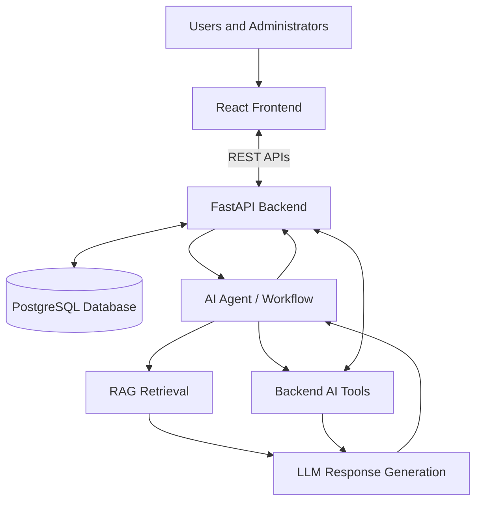
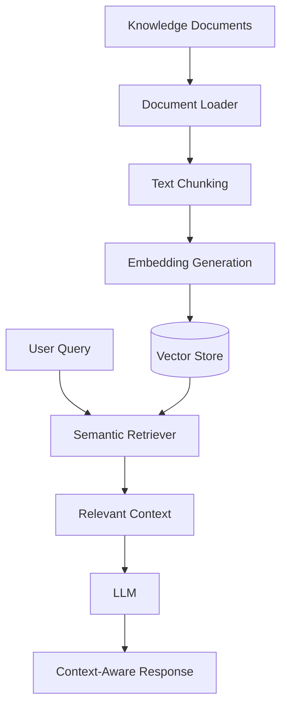
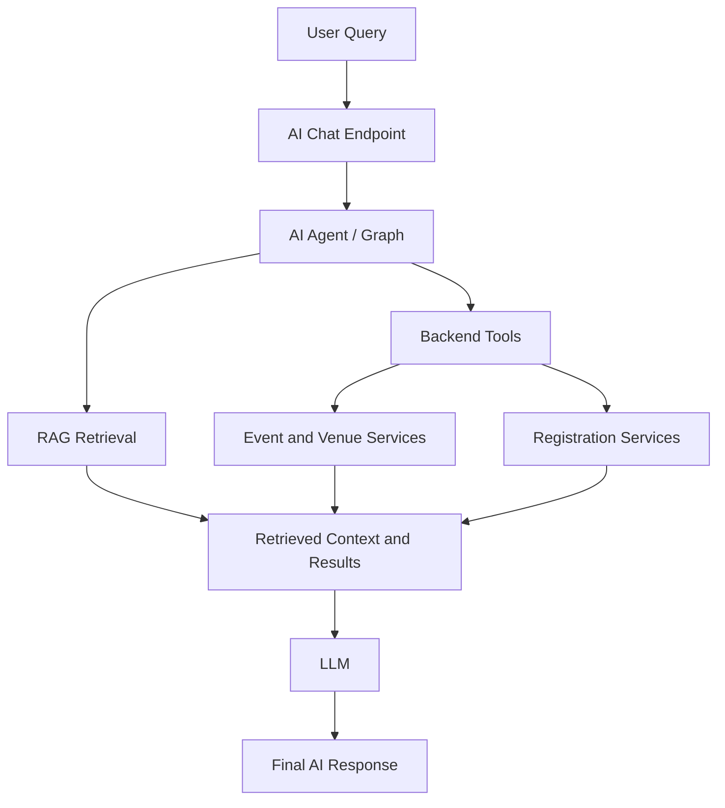

# 🎟️ Smart Event Management System

**An AI-Powered Full-Stack Event Management Platform**

A modern event management platform built with React, FastAPI, Python, PostgreSQL, RAG, LLMs, and AI agents. The system simplifies event discovery, registration, administration, and information retrieval through a centralized application with an integrated AI assistant.

---

## 📌 Project Overview

The **Smart Event Management System** is a full-stack web application developed as part of the Infosys Springboard Virtual Internship Program.

The platform provides an integrated environment for managing users, events, venues, registrations, payments, and feedback. It also incorporates an AI assistant that combines natural-language interaction, knowledge retrieval, and backend-integrated AI workflows.

### 🎯 Objectives

- Centralize event creation, discovery, and registration.
- Simplify event and user administration.
- Provide dedicated user and admin/organizer interfaces.
- Integrate RAG-based knowledge retrieval with LLM-powered responses.
- Enable AI workflows to interact with supported backend services.
- Build a modular architecture that can support future intelligent features.

## ✨ Key Features

### 👤 User Management
- User registration and authentication.
- User profile management.
- User lookup by ID or email.
- Role-based access support.
- Secure API-based communication.

### 🎫 Event Management
- Create, view, update, and delete events.
- Browse published events and event listings.
- Retrieve event details.
- Search and navigate event information.

### 📝 Registration Management
- Register for events.
- Retrieve registrations.
- View event-wise and user-wise registrations.
- Cancel event registrations.

### 🏢 Venue Management
- Create and manage venues.
- Retrieve venue information.
- Update venue details.
- Delete venue records.

### 💳 Payment Management
- Maintain payment records.
- Retrieve event-wise and user-wise payments.
- Update payment statuses.

### ⭐ Feedback Management
- Submit event feedback.
- Retrieve feedback by event or user.

### 🛡️ Admin and Organizer Dashboard
- Dashboard overview and metrics.
- Event management.
- Registration management.
- User management.
- Upcoming event listings.
- Search and navigation.
- Authentication and logout.
- Theme support.
- Backend API integration.

### 🤖 AI Assistant
- Natural-language interaction.
- Event-related queries.
- RAG-based knowledge retrieval.
- Context-aware LLM responses.
- AI chat sessions.
- Backend tool integration.
- Agent-based workflow support.

### 🧠 RAG and Semantic Retrieval
- Knowledge document processing.
- Text chunking and embedding generation.
- Vector-based knowledge storage.
- Semantic similarity search.
- Retrieval of relevant context for LLM responses.

### 🛠️ AI Agents and Backend Tools
- AI workflow orchestration.
- LLM-powered query processing.
- Integration with supported backend services.
- Retrieval of event-related information through application workflows.

---

## 🏗️ System Architecture

The application follows a modular architecture connecting the React frontend, FastAPI backend, PostgreSQL database, and AI/RAG layer.



### Architecture Components

| Component | Responsibility |
|---|---|
| React Frontend | User interface, event discovery, registration, and dashboards |
| FastAPI Backend | REST APIs, business logic, authentication, and application services |
| PostgreSQL | Persistent application data storage |
| AI Agent Workflow | Coordinates AI processing, retrieval, and tool usage |
| RAG Pipeline | Retrieves relevant knowledge for context-aware responses |
| LLM | Interprets queries and generates natural-language responses |
| Backend AI Tools | Connect AI workflows with supported application operations |

---

## 🧠 AI and RAG Architecture

### 1. RAG Pipeline

Retrieval-Augmented Generation combines knowledge retrieval with LLM response generation.



**Workflow:**

1. Load and process knowledge documents.
2. Split documents into manageable text chunks.
3. Generate embeddings using the configured embedding model.
4. Store embeddings in the vector store.
5. Retrieve relevant information through semantic similarity.
6. Provide the retrieved context to the LLM.
7. Generate a context-aware response.

### 2. Integrated AI Agent Workflow

The AI assistant combines knowledge retrieval and backend tools to respond to different types of user queries.



**Example workflow**

User query: *"Show me all available events."*

1. The user submits a natural-language query.
2. The AI chat endpoint passes the query to the AI workflow.
3. The workflow identifies the appropriate retrieval or backend tool.
4. The tool retrieves relevant application data.
5. The LLM generates a natural-language response using the available results.

RAG and backend tools serve different purposes: RAG retrieves relevant knowledge, while backend tools support interactions with application services.

---

## 🧩 Project Modules

| Module | Responsibility |
|---|---|
| Authentication | Registration, login, authentication, and authorization |
| Users | User information and user management |
| Events | Event creation, retrieval, updates, and deletion |
| Registrations | Event registration, retrieval, and cancellation |
| Venues | Venue management |
| Payments | Payment records and status management |
| Feedback | Event and user feedback |
| Admin | Administrative dashboard and management operations |
| RAG | Document processing, embeddings, and semantic retrieval |
| AI Assistant | Natural-language queries and intelligent responses |
| AI Agents | Workflow orchestration and tool usage |
| Backend AI Tools | Integration between AI workflows and application services |

---

## 🛠️ Technology Stack

### Frontend
- React
- Vite
- JavaScript / JSX
- CSS
- Lucide React

### Backend
- Python
- FastAPI
- Uvicorn
- Pydantic
- SQLAlchemy
- Alembic
- RESTful APIs

### Database
- PostgreSQL
- SQLAlchemy ORM
- Alembic database migrations
- Vector-based knowledge storage

### Artificial Intelligence
- Large Language Models (LLMs)
- Retrieval-Augmented Generation (RAG)
- Text embeddings
- Semantic search
- Vector database
- AI agents and workflow orchestration
- Backend-integrated AI tools
- Hugging Face Inference Providers

### Development and Testing
- Git and GitHub
- Node.js and npm
- uv
- Pytest
- FastAPI Swagger UI
- Docker Compose

---

## 📂 Project Structure

The repository separates the frontend and backend applications.

```text
Smart-Event-Management/
│
├── backend/
│   ├── app/
│   │   ├── main.py
│   │   └── ...
│   ├── alembic/
│   ├── tests/
│   ├── .env.example
│   ├── pyproject.toml
│   └── ...
│
├── frontend2/
│   ├── src/
│   ├── public/
│   ├── package.json
│   └── ...
│
├── docker-compose.yml
└── README.md
```

*Note: This is a high-level overview. The exact directory structure may vary depending on the repository's final contents.*

---

## ⚙️ Getting Started

### Prerequisites

Install the following tools:

- Python 3.x
- Node.js and npm
- PostgreSQL
- Git
- uv
- Docker and Docker Compose (optional)

### 1. Clone the Repository

```powershell
git clone https://github.com/swati-0505/Smart-Event-Management.git
cd Smart-Event-Management
```

### 2. Configure the Backend

Open a terminal in the repository root:

```powershell
cd backend
```

Create a local environment file from the example:

```powershell
Copy-Item .env.example .env
```

Configure the required variables in `backend/.env`, including:

- `DATABASE_URL` — PostgreSQL connection string.
- `SECRET_KEY` — a strong, unique application secret.
- Hugging Face access token with **Make calls to Inference Providers** permission.

Use the actual variable names defined in `.env.example` if they differ.

#### Configured AI Models

| Purpose | Model |
|---|---|
| LLM inference | `openai/gpt-oss-120b` |
| Text embeddings | `BAAI/bge-small-en-v1.5` |

Ensure PostgreSQL is running and the target database exists before continuing.

### 3. Install Backend Dependencies

Run from the `backend/` directory:

```powershell
uv sync
```

### 4. Apply Database Migrations

```powershell
uv run alembic upgrade head
```

The current embedding configuration uses **384-dimensional embeddings**. Ensure the database schema and vector column dimensions match the configured embedding model.

After applying the embedding migration, re-index existing knowledge documents using the admin knowledge-ingestion endpoint:

```http
POST /api/admin/knowledge/ingest?force=true
```

Use an authorized admin session or the authentication mechanism required by the endpoint.

### 5. Start the Backend Server

```powershell
uv run uvicorn app.main:app --reload
```

**Backend URL:** `http://127.0.0.1:8000`

**Health check:** `http://127.0.0.1:8000/health`

Expected response:

```json
{
  "status": "ok"
}
```

**Interactive API documentation:** `http://127.0.0.1:8000/docs`

### 6. Configure and Run the Frontend

Open a separate terminal from the repository root:

```powershell
cd frontend2
npm install
npm run dev
```

**Frontend URL:** `http://localhost:5173`

**Admin dashboard:** `http://localhost:5173/admin`

Ensure the frontend API configuration points to the running backend and the backend CORS settings allow the frontend origin.

### 7. Optional: Run with Docker Compose

From the repository root, after configuring the required environment variables and Docker services:

```powershell
docker compose up --build
```

Refer to the Compose configuration for the service ports and startup requirements.

---

## 🔌 API Overview

The backend organizes application functionality into REST API groups.

| API Prefix | Purpose |
|---|---|
| `/api/auth/` | Authentication and access management |
| `/api/users/` | User operations |
| `/api/events/` | Event management |
| `/api/registrations/` | Event registrations |
| `/api/venues/` | Venue management |
| `/api/payments/` | Payment records and statuses |
| `/api/feedback/` | Feedback management |
| `/api/admin/` | Administrative operations |
| `/api/chat/` | AI assistant and chat workflows |

**API testing:** Open `http://127.0.0.1:8000/docs` after starting the backend to inspect and test available endpoints.

Individual endpoints may require authentication and specific request parameters.

---

## 🖥️ Admin Dashboard

The administration interface provides centralized tools for managing the platform.

Key capabilities include:

- Dashboard metrics and overview.
- Event management.
- Registration management.
- User management.
- Upcoming event listings.
- Search and navigation.
- Admin authentication and logout.
- Theme support.
- Integration with backend services.
- Access to AI assistant functionality.

The frontend service layer communicates with the FastAPI backend through REST APIs.

---

## 🤖 AI Assistant in Action

The AI assistant is integrated into the application rather than operating solely as a general-purpose chatbot.

It is designed to combine natural-language query processing with relevant knowledge retrieval and supported backend operations.

### Example

**User:** "Show me the available events."

**Workflow:**

1. The query reaches the AI chat endpoint.
2. The AI workflow processes the request.
3. The appropriate event-related tool retrieves application data.
4. The retrieved results are provided to the LLM.
5. The assistant returns a natural-language response.

This approach enables users to interact with supported event-management functionality through conversational queries.

---

## 🧪 Build and Verification

### Frontend Production Build

Run from the `frontend2/` directory:

```powershell
npm run build
```

A successful build confirms that the frontend compiles into a production bundle.

### Backend Tests

Run from the `backend/` directory:

```powershell
uv run pytest -q
```

### Database Migrations

Run from the `backend/` directory:

```powershell
uv run alembic upgrade head
```

### Application Health Check

Send a `GET` request to:

```http
GET /health
```

Expected successful response:

```json
{
  "status": "ok"
}
```

Use the Swagger interface at `http://127.0.0.1:8000/docs` to test the available APIs.

---

## 🔒 Security Considerations

Recommended practices for secure configuration and deployment include:

- Store credentials and API tokens in environment variables.
- Never commit `.env` files or private credentials.
- Use strong, unique application secrets.
- Enforce authentication and role-based authorization.
- Validate incoming requests using Pydantic schemas.
- Configure appropriate CORS policies.
- Use HTTPS in production.
- Apply database access controls.
- Configure suitable token expiration and refresh mechanisms.
- Add rate limiting, logging, and monitoring where required.

Security depends on the actual implementation and deployment configuration of each feature.

---

## 🚀 Future Scope

The system provides a foundation for additional intelligent event-management capabilities, including:

- Personalized event recommendations.
- AI-powered event discovery.
- Automated event summaries and insights.
- Attendance and registration analytics.
- Intelligent FAQ and policy assistance.
- Enhanced administrative reporting.
- Calendar integration and event reminders.
- Advanced agentic workflows for supported event-management operations.

These are potential enhancements rather than claims about features already implemented.

---

## 🤝 Contributing

Contributions can be organized through Git feature branches and pull requests.

```bash
git checkout -b feature/your-feature

# Implement and test your changes

git add .
git commit -m "Describe your changes"
git push origin feature/your-feature
```

Open a pull request for review and integration.

---

## 📄 License and Acknowledgment

This project was developed as part of the **Infosys Springboard Virtual Internship Program** for educational and professional learning purposes.

The project provided an opportunity to apply full-stack development, database management, and AI/ML concepts to a collaborative software application.

No formal open-source license has been specified. A license can be added if the repository is intended for public reuse and distribution.

---

<p align="center">
  <strong>Smart Event Management System</strong>
  <br/>
  Bringing event management and intelligent AI assistance together.
</p>