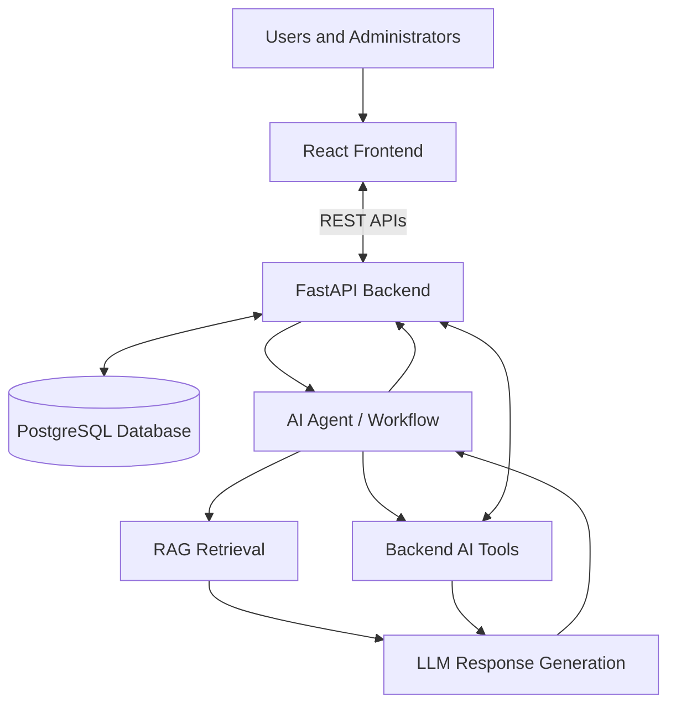
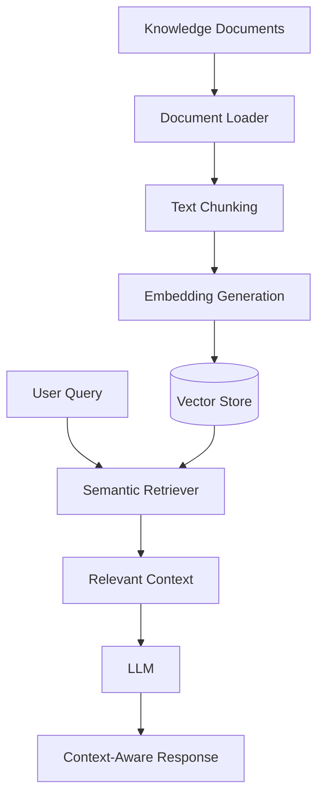
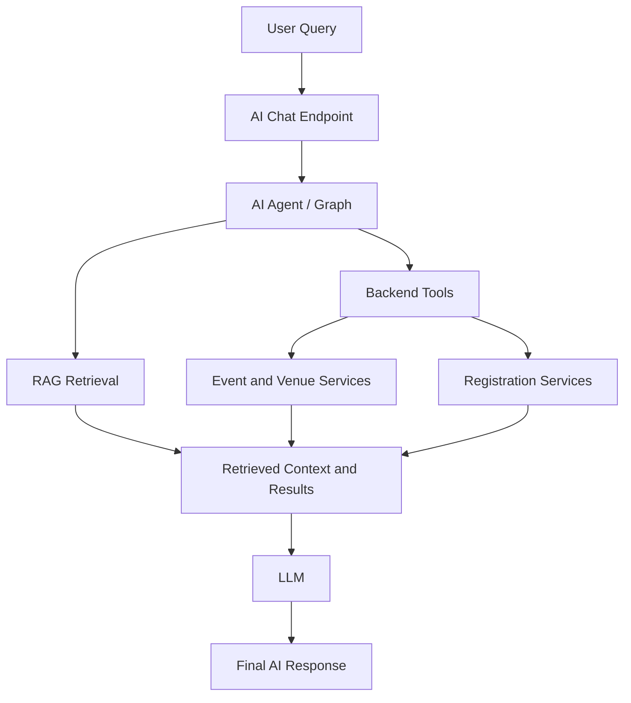

<h1 align="center">🎟️ SMART EVENT MANAGEMENT SYSTEM</h1>

<h3 align="center">Plan smarter. Register faster. Ask your AI.</h3>

<p align="center">
  <a href="https://github.com/swati-0505/Smart-Event-Management/actions/workflows/ci.yml"></a>
  
  
  
  
</p>

<p align="center">
  <b>A full-stack, AI-powered platform that brings event management and an intelligent assistant into one place.</b><br/>
  Built with <b>React</b> · <b>FastAPI</b> · <b>PostgreSQL</b> · <b>RAG</b> · <b>LLM Agents</b>
</p>

<p align="center">
  <a href="#getting-started"><b>Get Started</b></a> ·
  <a href="#system-architecture"><b>Architecture</b></a> ·
  <a href="#api-overview"><b>API</b></a> ·
  <a href="#team"><b>Team</b></a>
</p>

| 👥 Team | 🔌 API Modules | 🤖 LLM Providers | 🧪 Automated Tests | 🔁 CI |
|:---:|:---:|:---:|:---:|:---:|
| **8** builders | **9** REST groups | **3** with auto-fallback | **230+** | **GitHub Actions** |

> **Developed as part of the Infosys Springboard Virtual Internship Program.** The platform manages users, events, venues, registrations, payments, and feedback, and its AI assistant answers questions about live data and policies in plain English.

---

## 📌 PROJECT OVERVIEW

The **Smart Event Management System** is a full-stack web application developed as part of the Infosys Springboard Virtual Internship Program.

The platform provides an integrated environment for managing users, events, venues, registrations, payments, and feedback. Its AI assistant combines natural-language interaction, knowledge retrieval (RAG), and backend-integrated tools so that administrators and users can query live application data conversationally.

### 🎯 Objectives

- Centralize event creation, discovery, and registration.
- Simplify event and user administration.
- Provide dedicated user and admin/organizer interfaces.
- Integrate RAG-based knowledge retrieval with LLM-powered responses.
- Let AI workflows interact with application services through backend tools.
- Maintain a modular architecture that supports future intelligent features.

---

## ✨ KEY FEATURES

### 👤 User Management
- User registration and authentication.
- User profile management.
- User lookup by ID or email.
- Role-based access control.
- Secure, token-based API communication.

### 🎫 Event Management
- Create, view, update, and delete events.
- Browse published events and event listings.
- Retrieve event details.
- Search and navigate event information.

### 📝 Registration Management
- Register for events.
- Retrieve registrations.
- View event-wise and user-wise registrations.
- Cancel event registrations.

### 🏢 Venue Management
- Create and manage venues.
- Retrieve and update venue information.
- Delete venue records.

### 💳 Payment Management
- Maintain payment records.
- Retrieve event-wise and user-wise payments.
- Update payment statuses.

### ⭐ Feedback Management
- Submit event feedback.
- Retrieve feedback by event or user.

### 🛡️ Admin and Organizer Dashboard
- Dashboard overview and metrics.
- Event, registration, user, venue, payment, and feedback management.
- Upcoming event listings.
- Knowledge Base management and ingestion status.
- Agent Logs for AI run activity.
- Search, navigation, authentication, and logout.
- Theme support.

### 🤖 AI Assistant
- **Natural-language interaction** for events, venues, registrations, and policies.
- **RAG-based retrieval** for policy and FAQ questions.
- **Context-aware** LLM responses.
- **Persistent chat sessions** with conversation history.
- **Agent workflow** with backend tool integration.
- **Multi-provider routing** with automatic fallback.

### 🧠 RAG and Semantic Retrieval
- Knowledge document processing.
- Text chunking and embedding generation.
- Vector-based knowledge storage in PostgreSQL (pgvector).
- Semantic similarity search.
- Retrieval of relevant context for LLM responses, with answer-grounding checks.

---

<a id="system-architecture"></a>

## 🏗️ SYSTEM ARCHITECTURE

The application follows a modular architecture connecting the React frontend, FastAPI backend, PostgreSQL database, and AI/RAG layer.



### Architecture Components

| Component | Responsibility |
|---|---|
| React Frontend | User interface, event discovery, registration, and dashboards |
| FastAPI Backend | REST APIs, business logic, authentication, and application services |
| PostgreSQL | Persistent application data and vector storage |
| AI Agent Workflow | Coordinates reasoning, retrieval, and tool usage |
| RAG Pipeline | Retrieves relevant knowledge for context-aware responses |
| LLM Router | Routes requests across configured LLM providers with fallback |
| Backend AI Tools | Connect AI workflows with supported application operations |

---

## 🧠 AI AND RAG ARCHITECTURE

### 1. RAG Pipeline

Retrieval-Augmented Generation combines knowledge retrieval with LLM response generation.



**Workflow:**

1. Load and process knowledge documents.
2. Split documents into manageable text chunks.
3. Generate embeddings using the configured embedding model.
4. Store embeddings in the vector store.
5. Retrieve relevant information through semantic similarity.
6. Provide the retrieved context to the LLM.
7. Verify the answer is grounded in the retrieved context.
8. Return the context-aware response.

### 2. Integrated AI Agent Workflow

The AI assistant combines knowledge retrieval and backend tools to respond to different types of user queries.



**Example workflow**

User query: *"Show me all upcoming events."*

1. The user submits a natural-language query.
2. The chat endpoint passes the query to the agent workflow.
3. The agent selects the appropriate retrieval or backend tool.
4. The tool retrieves application data.
5. The LLM generates a natural-language response from the results.

RAG retrieves knowledge (policies, FAQs), while backend tools read and act on live application data. The agent loop is bounded by `AGENT_MAX_TOOL_LOOPS` to keep responses fast and predictable.

### 3. Multi-Provider LLM Router

LLM calls go through a provider router that tries each configured provider in order and falls back automatically when one fails or is rate-limited. Providers without an API key are skipped.

| Provider | Purpose |
|---|---|
| Groq | Fast inference (OpenAI-compatible API) |
| Google Gemini | Reliable general-purpose model |
| OpenRouter | Primary/fallback model routing, including free-tier models |

OpenRouter also supplies the text embeddings used by the RAG pipeline. Optional LangSmith tracing can be enabled for run observability.

---

## 🧩 PROJECT MODULES

| Module | Responsibility |
|---|---|
| Authentication | Registration, login, authentication, and authorization |
| Users | User information and user management |
| Events | Event creation, retrieval, updates, and deletion |
| Registrations | Event registration, retrieval, and cancellation |
| Venues | Venue management |
| Payments | Payment records and status management |
| Feedback | Event and user feedback |
| Admin | Administrative dashboard, knowledge base, and agent activity |
| RAG | Document processing, embeddings, and semantic retrieval |
| AI Assistant | Natural-language queries, chat sessions, and responses |
| AI Agents | Workflow orchestration and tool usage |
| LLM Router | Multi-provider model routing with fallback |

---

## 🗄️ DATABASE

- **PostgreSQL** with the **pgvector** extension for vector storage.
- **SQLAlchemy ORM** for data access.
- **Alembic** for schema migrations.

Core data entities follow the application modules: users, events, venues, registrations, payments, feedback, chat sessions and messages, agent run records, and knowledge document chunks with embeddings.

---

## 🛠️ TECHNOLOGY STACK

### Frontend
- React
- Vite
- JavaScript / JSX
- CSS
- Lucide React

### Backend
- Python
- FastAPI
- Uvicorn
- Pydantic
- SQLAlchemy
- Alembic
- RESTful APIs

### Database
- PostgreSQL
- SQLAlchemy ORM
- Alembic database migrations
- pgvector for vector-based knowledge storage

### Artificial Intelligence
- Large Language Models (LLMs)
- Retrieval-Augmented Generation (RAG)
- Text embeddings and semantic search
- AI agents and workflow orchestration (LangGraph)
- Backend-integrated AI tools
- Multi-provider routing: Groq, Google Gemini, OpenRouter
- LangSmith tracing (optional)

### Development and Testing
- Git and GitHub
- GitHub Actions (CI)
- Node.js and npm
- uv
- Pytest
- FastAPI Swagger UI
- Docker Compose

---

## 📂 PROJECT STRUCTURE

```text
Smart-Event-Management/
│
├── .github/
│   └── workflows/
│       └── ci.yml
│
├── backend/
│   ├── app/
│   │   ├── main.py
│   │   ├── agent/        # agent graph and nodes
│   │   ├── llm/          # provider router, config, providers
│   │   ├── rag/          # chunking, embeddings, retrieval, generation
│   │   ├── tools/        # backend tools used by the agent
│   │   └── ...
│   ├── alembic/
│   ├── tests/
│   ├── .env.example
│   ├── pyproject.toml
│   └── ...
│
├── frontend2/
│   ├── src/
│   ├── public/
│   ├── package.json
│   └── ...
│
├── docs/
│   └── CONTRIBUTORS.md
│
├── docker-compose.yml
└── README.md
```

---

<a id="getting-started"></a>

## ⚙️ GETTING STARTED

### Prerequisites

- Python 3.11+
- Node.js 20+ and npm
- PostgreSQL with the pgvector extension
- Git
- uv
- Docker and Docker Compose (optional)

### 1. Clone the Repository

```powershell
git clone https://github.com/swati-0505/Smart-Event-Management.git
cd Smart-Event-Management
```

### 2. Configure the Backend

```powershell
cd backend
Copy-Item .env.example .env
```

Set the following in `backend/.env` (use the exact names from `.env.example`):

| Variable | Purpose |
|---|---|
| `DATABASE_URL` | PostgreSQL connection string |
| `SECRET_KEY` | Strong, unique application secret |
| `OPENROUTER_API_KEY` | OpenRouter key (chat fallback and embeddings) |
| `OPENROUTER_MODEL` | Primary OpenRouter chat model |
| `OPENROUTER_FALLBACK_MODELS` | Comma-separated fallback models |
| `GROQ_API_KEY`, `GROQ_MODEL` | Optional Groq provider |
| `GEMINI_API_KEY`, `GEMINI_MODEL` | Optional Gemini provider |
| `OPENROUTER_EMBEDDING_MODEL` | Embedding model for RAG |
| `OPENROUTER_EMBEDDING_DIM` | Embedding vector dimension (must match the database vector column) |
| `LLM_TIMEOUT_SECONDS`, `LLM_MAX_RETRIES` | LLM request timeout and retries |
| `AGENT_MAX_TOOL_LOOPS` | Maximum agent tool-call iterations per request |
| `LANGSMITH_TRACING` | `true` or `false` (optional tracing) |

> 💡 **Tip:** Free-tier models have request limits, so use a provider with a separate quota (Groq or Gemini) as the primary or fallback.

Ensure PostgreSQL is running and the target database exists before continuing.

### 3. Install Backend Dependencies

```powershell
uv sync
```

### 4. Apply Database Migrations

```powershell
uv run alembic upgrade head
```

The embedding dimension in `.env` must match the vector column in the database. After changing the embedding model or dimension, re-index the knowledge documents:

```http
POST /api/admin/knowledge/ingest?force=true
```

Use an authorized admin session for this endpoint.

### 5. Start the Backend Server

```powershell
uv run uvicorn app.main:app --reload
```

- **Backend URL:** `http://127.0.0.1:8000`
- **Interactive API documentation:** `http://127.0.0.1:8000/docs`
- **Health check:** `http://127.0.0.1:8000/health` returns `{"status": "ok"}`

### 6. Configure and Run the Frontend

Open a separate terminal from the repository root:

```powershell
cd frontend2
npm install
npm run dev
```

- **Frontend URL:** `http://localhost:5173` (Vite uses the next free port if 5173 is busy)
- **Admin dashboard:** `/admin`
- **AI assistant:** `/admin/ai-chat`

Make sure the frontend API configuration points to the running backend and that the backend CORS settings allow the frontend origin.

### 7. Optional: Run with Docker Compose

```powershell
docker compose up --build
```

Refer to `docker-compose.yml` for service ports and startup requirements.

---

<a id="api-overview"></a>

## 🔌 API OVERVIEW

| API Prefix | Purpose |
|---|---|
| `/api/auth/` | Authentication and access management |
| `/api/users/` | User operations |
| `/api/events/` | Event management |
| `/api/registrations/` | Event registrations |
| `/api/venues/` | Venue management |
| `/api/payments/` | Payment records and statuses |
| `/api/feedback/` | Feedback management |
| `/api/admin/` | Dashboard, knowledge base, and agent activity |
| `/api/chat/` | AI assistant, chat sessions, and history |

Open `http://127.0.0.1:8000/docs` to inspect and test all endpoints. Most endpoints require authentication.

---

## 🖥️ ADMIN DASHBOARD

The administration interface provides centralized tools for managing the platform:

- Dashboard metrics and overview.
- Events, registrations, users, venues, payments, and feedback management.
- AI Assistant with conversation history.
- Knowledge Base status and document ingestion.
- Agent Logs showing AI run activity.
- Admin authentication, logout, and theme support.

---

## 🤖 AI ASSISTANT IN ACTION

The assistant is integrated into the application rather than operating as a general-purpose chatbot.

**Example prompts**

- "Show me upcoming events."
- "Show all venues."
- "How many registrations does an event have?"
- "What is the refund policy?" (answered through RAG)

Questions about live data are answered through backend tools, and policy or FAQ questions are answered through retrieval over the knowledge base.

---

## 🧪 BUILD AND VERIFICATION

### Backend Tests

```powershell
cd backend
uv run pytest -q
```

The suite contains 230+ automated tests. Database-backed tests need a disposable PostgreSQL test database (with pgvector) set through the `TEST_DATABASE_URL` environment variable; they are skipped when it is not set.

```powershell
$env:TEST_DATABASE_URL = "postgresql://postgres:<password>@localhost:5432/event_management_test"
uv run pytest -q
```

> ⚠️ **Warning:** Never point `TEST_DATABASE_URL` at a development or production database, because the tests create and drop tables.

### Frontend Production Build

```powershell
cd frontend2
npm run build
```

### Continuous Integration

A GitHub Actions workflow (`.github/workflows/ci.yml`) runs on every push and pull request:

- **Backend:** installs dependencies with uv and runs the full test suite against a PostgreSQL + pgvector service container.
- **Frontend:** installs dependencies with `npm ci` and runs the production build.

### Database Migrations

```powershell
cd backend
uv run alembic upgrade head
```

---

## 🔒 SECURITY CONSIDERATIONS

- Credentials and API tokens are stored in environment variables.
- `.env` files are excluded from version control; only `.env.example` is committed.
- Authentication and role-based authorization protect the API.
- Incoming requests are validated with Pydantic schemas.
- CORS is configured for the frontend origin.
- Use HTTPS, strong secrets, and database access controls in production.
- Rotate any API key that has been exposed.

---

## 🚀 FUTURE SCOPE

- Personalized event recommendations.
- AI-powered event discovery and automated event summaries.
- Attendance and registration analytics.
- Enhanced administrative reporting.
- Calendar integration and event reminders.
- Automated deployment (CD) to a cloud platform.
- Streaming responses for the AI assistant.

---

<a id="team"></a>

## 👥 TEAM

This project was built by a team of 8 contributors:

[Nithin](https://github.com/MamidiNithin11) · [Swati](https://github.com/swati-0505) · [Pushpa](https://github.com/uppupushpa) · [Yugant](https://github.com/Yugantt) · [Sravanthi](https://github.com/Sravanthi1410) · [Sushmitha](https://github.com/Susmitha967) · [Sonali](https://github.com/sonali110806) · [Sumit](https://github.com/sumitgundappa26-wq)

See the full team page: **[docs/CONTRIBUTORS.md](docs/CONTRIBUTORS.md)**

<a href="https://github.com/swati-0505/Smart-Event-Management/graphs/contributors">
  
</a>

---

## 🤝 CONTRIBUTING

Contributions are organized through Git feature branches and pull requests.

```bash
git checkout -b feature/your-feature

# Implement and test your changes

git add .
git commit -m "Describe your changes"
git push origin feature/your-feature
```

Open a pull request for review. The CI workflow must pass before merging.

---

## 📄 LICENSE AND ACKNOWLEDGMENT

This project was developed as part of the **Infosys Springboard Virtual Internship Program** for educational and professional learning purposes.

The project provided an opportunity to apply full-stack development, database management, and AI/ML concepts to a collaborative software application.

No formal open-source license has been specified. A license can be added if the repository is intended for public reuse and distribution.

---

<p align="center">
  <strong>Smart Event Management System</strong>
  <br/>
  Bringing event management and intelligent AI assistance together.
</p>